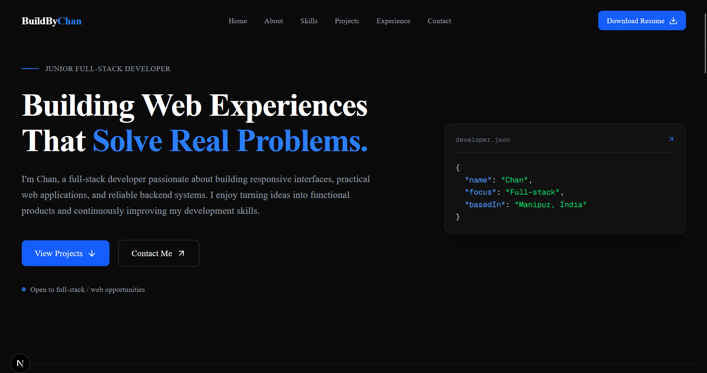
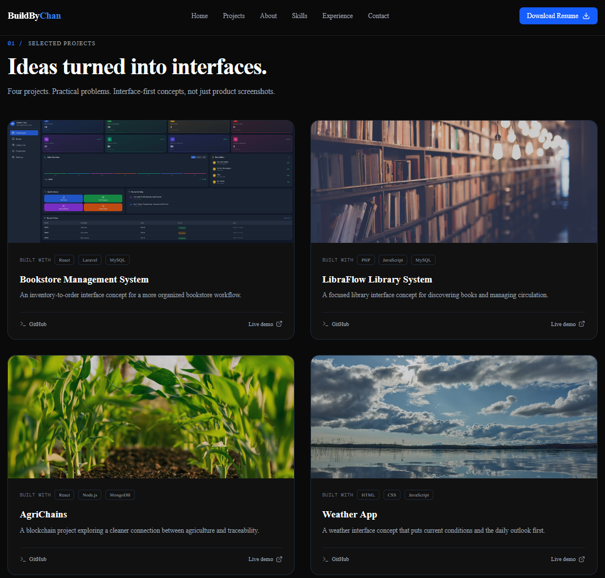
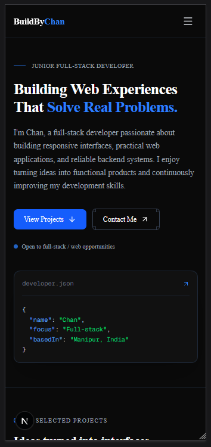

# BuildByChan | Developer Portfolio

A modern, responsive, and accessible developer portfolio built to showcase my skills, projects, and achievements as a Junior Full-Stack Developer.

🔗 **Live Demo:** [https://your-portfolio-url.vercel.app](https://your-portfolio-url.vercel.app) 



### 📱 Responsive Design & Project Showcase

| Desktop Projects View | Mobile View |
| :---: | :---: |
|  |  |

## 🚀 Tech Stack

- **Framework:** [Next.js](https://nextjs.org/) (App Router)
- **Language:** [TypeScript](https://www.typescriptlang.org/)
- **Styling:** [Tailwind CSS](https://tailwindcss.com/)
- **Icons:** [Lucide React](https://lucide.dev/)
- **Deployment:** [Vercel](https://vercel.com/) *(or your host of choice)*

## ✨ Features

- **Fully Responsive:** Optimized for mobile, tablet, and desktop viewing.
- **Modern UI/UX:** Dark mode aesthetic with a clean, minimalistic layout and blue accent colors.
- **Interactive Navigation:** Fixed navbar with smooth scrolling and a mobile hamburger menu that automatically closes on scroll or outside clicks.
- **Accessible Details Pages:** Dedicated pages for achievements (Hackathon & Typing Competition) featuring accessible image lightboxes/modals.
- **Optimized Performance:** Built with Next.js for fast load times, image optimization, and SEO readiness.

## 🛠️ Getting Started

To run this project locally, follow these steps:

### Prerequisites
Make sure you have Node.js (v18.18 or later) installed on your machine.

### Installation

1. Clone the repository:
   ```bash
   git clone https://github.com/Chan420-cyber/your-repo-name.git